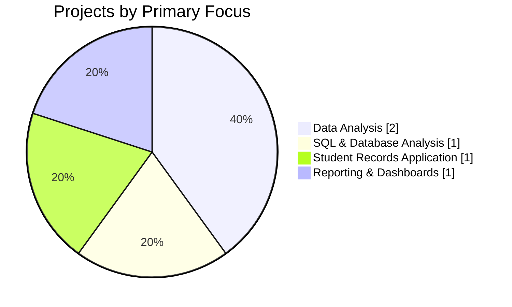
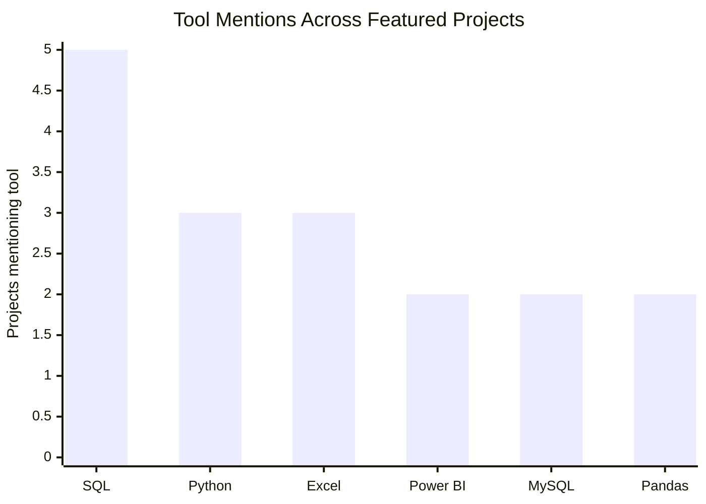
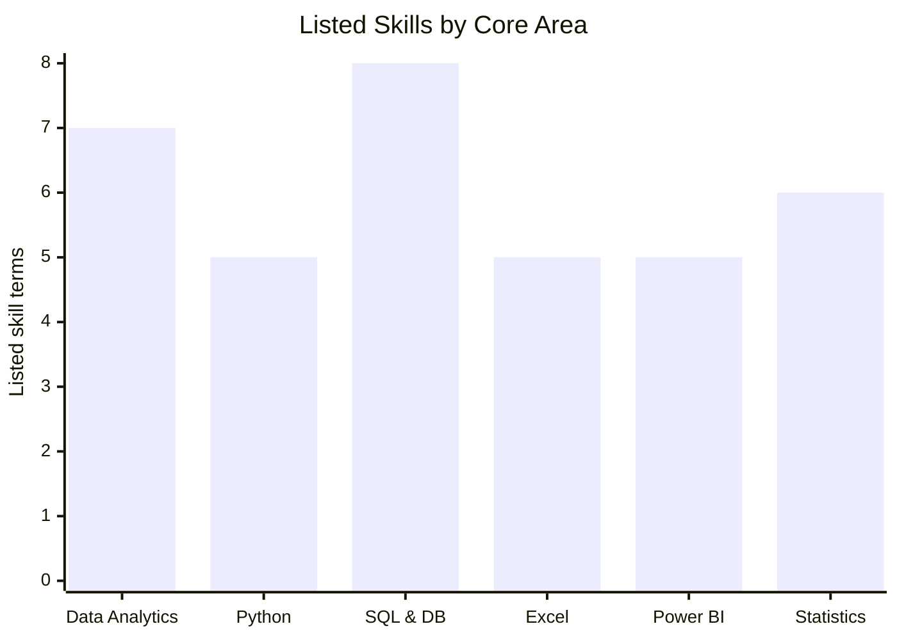

# 📊 Data Analytics Portfolio Dashboard

> A Power BI-inspired overview of the projects and skills listed in this GitHub profile.  
> **Scope:** This dashboard summarizes portfolio documentation, not business dataset results. No sales, revenue, grades, or other real-world performance values are inferred.

## Portfolio at a Glance

| Portfolio KPI | Count | Definition |
|---|---:|---|
| Featured projects | 5 | Projects listed in the profile README |
| Analytics/reporting projects | 4 | Student Data Analysis, SQL Data Analysis, Sales Data Analysis, and Data Reporting & Dashboard Practice |
| Database/application project | 1 | Student Management System |
| Core analytics tool groups | 6 | Data Analytics, Python, SQL & Databases, Excel, Power BI, and Statistics |

## 1. Project Portfolio Mix

Each project is counted once and assigned to its primary focus based on its README description.

**Insight:** The portfolio is primarily centered on data analysis, with additional work represented in SQL/database querying, student record management, and dashboard/reporting practice.

## 2. Tools Across Featured Projects

Counts represent the number of featured project descriptions that mention each tool. A project can mention multiple tools, so these counts are not mutually exclusive.

| Tool | Projects mentioning it |
|---|---:|
| SQL | 5 |
| Python | 3 |
| Excel | 3 |
| Power BI | 2 |
| MySQL | 2 |
| Pandas | 2 |

## 3. Skills by Area

This chart summarizes the six core skill groups in the profile README. Values are counts of listed skill terms, not proficiency scores.

## 4. Portfolio Coverage Matrix

| Project | Python | SQL / MySQL | Excel | Power BI / Dashboards |
|---|:---:|:---:|:---:|:---:|
| Student Data Analysis | ✓ | ✓ | ✓ | — |
| SQL Data Analysis | — | ✓ | — | — |
| Sales Data Analysis | ✓ | ✓ | ✓ | ✓ |
| Student Management System | ✓ | ✓ | — | — |
| Data Reporting & Dashboard Practice | — | ✓ | ✓ | ✓ |

## 5. Key Takeaways

- **SQL is mentioned in all five featured project descriptions.**
- **Python and Excel** are recurring tools for analysis and reporting workflows.
- **Power BI and dashboard practice** are represented in sales analysis and reporting/dashboard work.
- The portfolio currently documents five featured projects across analysis, database work, student records, and reporting.

## Data Notes

- Source: [Profile README](https://github.com/chintookumaranalytics/chintookumaranalytics/blob/main/README.md).
- Counts are derived from the project and skills descriptions in that README.
- These charts are **portfolio summaries**, not live GitHub activity statistics or business-performance dashboards.
- To build a true business Power BI-style dashboard (for example, sales trends, profit, KPIs, monthly growth, or student performance), add the underlying CSV/Excel dataset or a project repository containing structured data.
