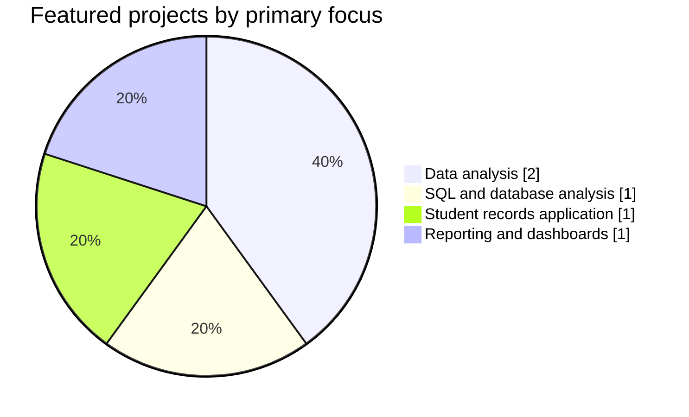
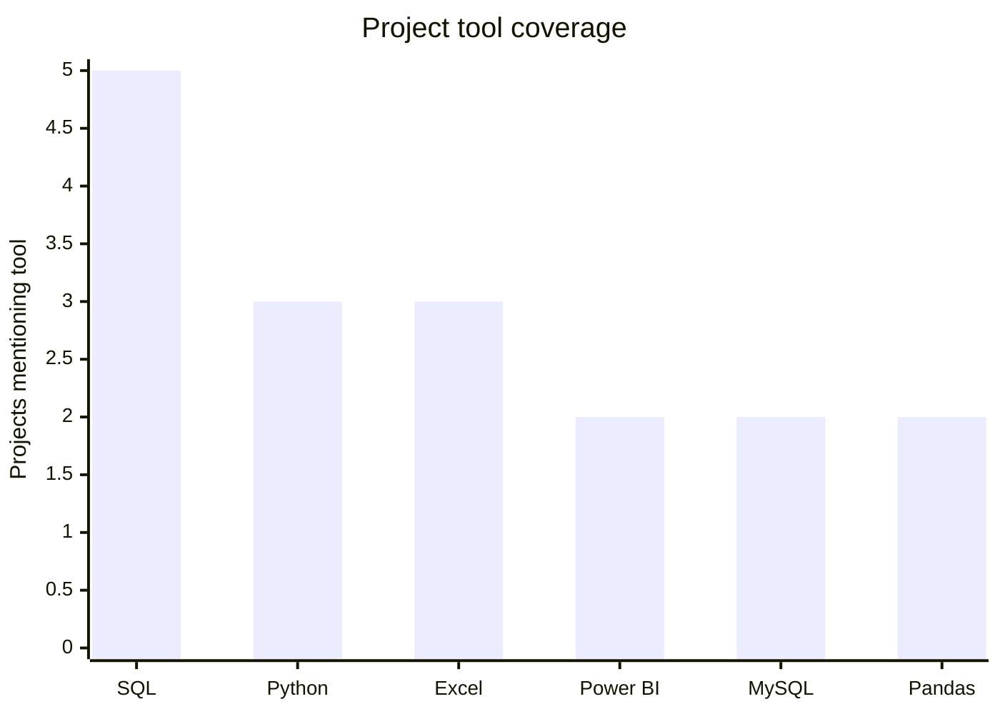

<!-- Power BI-inspired GitHub profile dashboard -->

**Turning structured data into clear analysis, useful KPIs, and understandable visual reports.**

[About](#-about) · [Dashboard](#-portfolio-dashboard) · [Projects](#-featured-projects) · [Skills](#-analytics-toolkit) · [GitHub Stats](#-github-activity) · [Connect](#-connect)

---

## 👤 About

I'm **Chintoo Kumar**, a Bachelor of Computer Applications (BCA) student at **Inderprastha Engineering College** (2024–2027), focused on Data Analytics and Business Intelligence.

My work and learning focus on data cleaning, exploratory data analysis (EDA), SQL querying, Python-based analysis, Excel reporting, Power BI dashboards, KPI analysis, and communicating findings clearly. I enjoy finding patterns in structured data and presenting results in a way that supports better decisions.

**Current toolkit:** Python · Pandas · NumPy · SQL · MySQL · Microsoft Excel · Power BI · Statistics

---

## 📊 Portfolio Dashboard

> **Dashboard note:** The figures below summarize projects documented in this profile README. They are portfolio counts, not business-performance results.

<table>
<tr>
<td width="25%" align="center">

### 05
**Featured Projects**

</td>
<td width="25%" align="center">

### 05
**Projects Mentioning SQL**

</td>
<td width="25%" align="center">

### 03
**Projects Mentioning Python**

</td>
<td width="25%" align="center">

### 02
**Projects Mentioning Power BI**

</td>
</tr>
</table>

### Project mix

### Tools mentioned across projects

Counts are based on the tools named in each project description. A project may use multiple tools.

### Portfolio observations

- **SQL** appears across all five featured project descriptions.
- **Python** and **Excel** are recurring tools for analysis and reporting.
- **Power BI** is represented in sales analysis and dashboard/reporting practice.
- The portfolio combines analysis work with database and student-record management practice.

[**Open the detailed Markdown dashboard →**](DATA_ANALYTICS_DASHBOARD.md)

---

## 📁 Featured Projects

| Project | Focus | Tools |
|---|---|---|
| **Student Data Analysis** | Explore student data, identify patterns, and analyze performance | Python, Pandas, NumPy, SQL, Excel |
| **Sales Data Analysis** | Sales performance, trends, product analysis, and KPIs | Python, Pandas, SQL, Excel, Power BI |
| **SQL Data Analysis** | Query, filter, join, aggregate, and analyze structured data | SQL, MySQL, DBMS |
| **Data Reporting & Dashboard Practice** | Turn datasets into reports, KPIs, charts, and dashboards | Excel, Power BI, SQL |
| **Student Management System** | Manage student records and database operations | Python, SQL, MySQL |

*Project descriptions reflect the information currently documented in this profile. Add individual repository links when the projects have their own published repositories.*

---

## 🧰 Analytics Toolkit

| Area | Skills and tools |
|---|---|
| **Data analytics** | Data cleaning, EDA, data analysis, visualization, reporting, KPI and trend analysis |
| **Python** | Python, Pandas, NumPy, data manipulation |
| **SQL & databases** | SQL, MySQL, DBMS, joins, aggregations, subqueries, CRUD |
| **Excel** | Data cleaning, formulas, PivotTables, charts, reporting |
| **Power BI** | Dashboards, KPIs, reports, data visualization |
| **Statistics** | Descriptive statistics, mean, median, mode, percentage and distribution analysis |

### Project coverage matrix

| Project | Python | SQL / MySQL | Excel | Power BI |
|---|:---:|:---:|:---:|:---:|
| Student Data Analysis | ✓ | ✓ | ✓ | — |
| Sales Data Analysis | ✓ | ✓ | ✓ | ✓ |
| SQL Data Analysis | — | ✓ | — | — |
| Data Reporting & Dashboard Practice | — | ✓ | ✓ | ✓ |
| Student Management System | ✓ | ✓ | — | — |

---

## 🎓 Education

**Bachelor of Computer Applications (BCA)**  
Inderprastha Engineering College · 2024–2027

Academic focus includes database management, programming fundamentals, analytical problem-solving, and applying technical concepts through practical work.

---

## 📈 GitHub Activity

*GitHub statistic cards are generated by external services and may be temporarily unavailable or cached. Language cards reflect repository code, not a measure of skill level.*

---

## 🎯 Current Learning Focus

- Strengthening SQL querying and database analysis
- Practicing Python data analysis with Pandas and NumPy
- Improving Excel-based reporting and analysis
- Building Power BI dashboards and clear KPI views
- Developing stronger statistical reasoning and insight communication

---

## 🏅 Certification

**AI Literacy Certification** — *Your Top AI Questions Answered: AI Literacy for Everyone*

[View certifications on LinkedIn](https://www.linkedin.com/in/chintookumardev/details/certifications/)

---

## 🤝 Connect

**Data Analytics · SQL · Python · Excel · Power BI**

